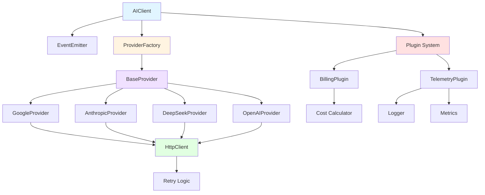
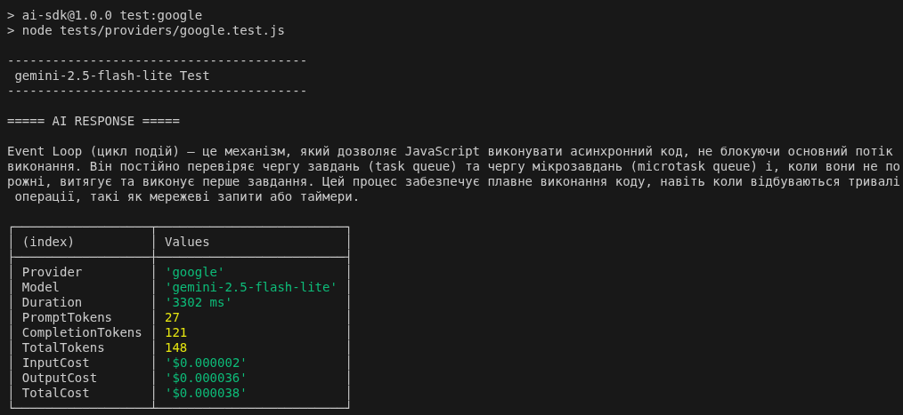
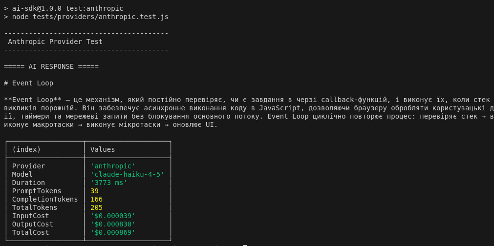
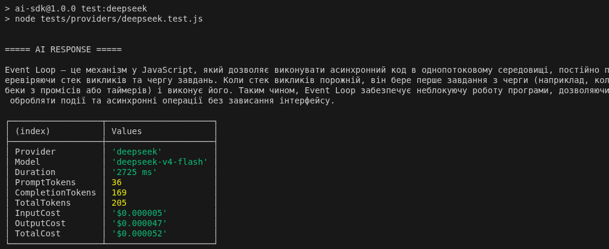
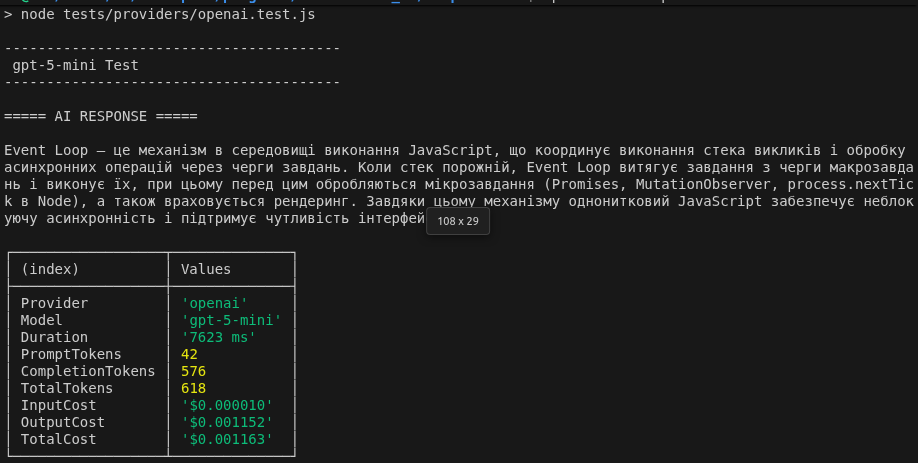

# AI Providers

[](https://www.npmjs.com/package/@testapiw/ai-providers)
[](https://opensource.org/licenses/ISC)

A unified JavaScript SDK for interacting with multiple AI provider APIs (OpenAI, Anthropic, Google, DeepSeek).

**Published on npm**: [@testapiw/ai-providers](https://www.npmjs.com/package/@testapiw/ai-providers)

**Changelog**: [CHANGELOG.md](./CHANGELOG.md) — current release is `3.0.1` (documentation-only; the breaking provider API changes from `3.0.0` are described below).

## Installation

```bash
npm install @testapiw/ai-providers
```

**Available Exports:**
```javascript
import AIClient from "@testapiw/ai-providers";              // Default export
import { Plugin, BillingPlugin, TelemetryPlugin } from "@testapiw/ai-providers"; // Named exports
```

## Quick Start

```javascript
import AIClient, { BillingPlugin, TelemetryPlugin } from "@testapiw/ai-providers";
import models from "./config/models.json" with { type: "json" };

// Initialize client with plugins
const ai = new AIClient({ 
    models,
    http: {
        timeout: 60000,
        retries: 3,
        retryDelay: 1000
    }
}).plugins(
    new BillingPlugin(),
    new TelemetryPlugin()
);

const response = await ai.generate({
    model: "gemini-3.6-flash",
    system: "You are a helpful assistant.",
    prompt: "What is the Event Loop in JavaScript?"
});

console.log(response.text);
console.log(`Cost: $${response.cost.total.toFixed(6)}`);
```

## Overview

This library provides a simplified abstraction layer for working with multiple AI provider APIs through a unified interface. It demonstrates key capabilities including:

- **Multi-provider support**: OpenAI, Anthropic (Claude), Google (Gemini), DeepSeek
- **Plugin architecture**: Modular system for extending functionality
- **Event system**: Lifecycle events for monitoring and customization
- **Automatic retry logic**: Handles transient failures with configurable retry policies
- **Cost tracking**: Via BillingPlugin for detailed usage analytics
- **Telemetry**: Via TelemetryPlugin for logging and metrics
- **Provider abstraction**: Single interface for all AI providers

## Architecture



## Project Structure

```
ai-providers/
├── config/
│   ├── models.json          # Model configurations and pricing
│   └── settings.js          # Environment variables and settings
├── src/
│   ├── index.js            # Main entry point (exports AIClient, plugins)
│   ├── core/
│   │   ├── AIClient.js         # Main client class
│   │   ├── EventEmitter.js     # Event system for lifecycle hooks
│   │   ├── Plugin.js           # Base plugin class
│   │   ├── HttpClient.js       # HTTP wrapper with retry support
│   │   ├── ProviderFactory.js  # Provider instantiation
│   │   └── Retry.js            # Retry logic implementation
│   ├── plugins/
│   │   ├── BillingPlugin/
│   │   │   ├── BillingPlugin.js # Cost tracking plugin
│   │   │   └── Billing.js      # Billing logic
│   │   └── TelemetryPlugin/
│   │       ├── TelemetryPlugin.js # Telemetry plugin
│   │       ├── Logger.js       # File-based logging
│   │       ├── Metrics.js      # Performance metrics
│   │       ├── FileWriter.js   # Async file writing
│   │       ├── FileRotation.js # Log rotation
│   │       └── Mutex.js        # File write synchronization
│   ├── providers/
│   │   ├── BaseProvider.js     # Abstract base provider
│   │   ├── GoogleProvider.js   # Google Gemini implementation
│   │   ├── AnthropicProvider.js # Claude implementation
│   │   ├── DeepSeekProvider.js  # DeepSeek implementation
│   │   └── OpenAIProvider.js    # OpenAI implementation
│   ├── errors/
│   │   └── AIError.js      # Custom error types
│   └── utils/
│       └── sleep.js        # Async delay utility
├── tests/
│   ├── integration/        # Integration tests
│   └── providers/          # Provider-specific tests
└── logs/                   # Telemetry output directory
```

## Configuration

### Environment Variables

Create a `.env` file with your API keys:

```env
# Google (Gemini)
GEMINI_API_KEY_FREE=your_free_tier_key
GEMINI_API_KEY_PAID=your_paid_tier_key

# Anthropic (Claude)
ANTHROPIC_API_KEY=your_anthropic_key

# DeepSeek
DEEPSEEK_API_KEY=your_deepseek_key

# OpenAI
OPENAI_API_KEY=your_openai_key

# HTTP settings (optional)
AI_TIMEOUT=60000
AI_RETRIES=3
AI_RETRY_DELAY=1000
```

### Models Configuration (`config/models.json`)

Define available models with their settings:

```json
{
  "models": {
    "gemini-3.6-flash": {
      "displayName": "Gemini 3.6 Flash (Google)",
      "provider": "google",
      "apiModel": "gemini-3.6-flash",
      "api": "interactions",
      "apiTier": "free",
      "maxTokens": 8192,
      "capabilities": {
        "temperature": false,
        "reasoning": true
      },
      "pricing": {
        "input_per_1m": 0.75,
        "output_per_1m": 3.75,
        "cached_input_per_1m": 0.075
      }
    }
  }
}
```

**Configuration Keys:**
- `displayName`: Human-readable model name
- `provider`: Provider identifier (google, anthropic, deepseek, openai)
- `apiModel`: Actual model name used in API requests
- `temperature`: Default temperature for generation (ignored when `capabilities.temperature` is `false`)
- `maxTokens`: Default maximum output tokens
- `effort`: Default reasoning effort (`low` | `medium` | `high`; provider-specific mapping, ignored by Google)
- `thinking`: Provider-specific thinking config (for Anthropic `{ "type": "adaptive" }`, for DeepSeek `{ "type": "enabled" }`)
- `apiTier`: Tier indicator (for Google: `"free"` or `"paid"` — selects `GEMINI_API_KEY_FREE` / `GEMINI_API_KEY_PAID`)
- `api`: API type (for Google: `"interactions"`)
- `capabilities`: Feature flags
  - `temperature`: Whether the model accepts the `temperature` parameter
  - `reasoning`: Whether the model exposes reasoning/thinking tokens
- `pricing`: Cost per 1 million tokens
  - `input_per_1m`: Input token cost
  - `output_per_1m`: Output token cost (reasoning/thinking tokens are billed as output)
  - `cached_input_per_1m`: Discounted cached input token cost
  - `cache_write_per_1m`: Cache write cost (Anthropic)

### Client Configuration

```javascript
import AIClient, { BillingPlugin, TelemetryPlugin } from "@testapiw/ai-providers";
import models from "./config/models.json" with { type: "json" };

// Initialize client
const ai = new AIClient({
    models: models,           // Models configuration object
    http: {
        timeout: 60000,       // Request timeout in milliseconds
        retries: 3,           // Number of retry attempts
        retryDelay: 1000      // Delay between retries in ms
    }
});

// Add plugins (optional)
ai.plugins(
    new BillingPlugin(),      // Cost tracking and billing
    new TelemetryPlugin()     // Logging and metrics
);
```

**Available Plugins:**
- `BillingPlugin`: Tracks API costs and usage
- `TelemetryPlugin`: Provides logging and metrics collection

## Features

### Automatic Retry

The SDK automatically retries failed requests for:
- **HTTP Status Codes**: 408, 429 (Rate Limit), 500, 502, 503, 504, 529
- **Network Errors**: `ECONNRESET`, `ECONNREFUSED`, `ETIMEDOUT`, `EPIPE`, `EAI_AGAIN` and undici codes (`UND_ERR_CONNECT_TIMEOUT`, `UND_ERR_HEADERS_TIMEOUT`, `UND_ERR_BODY_TIMEOUT`, `UND_ERR_SOCKET`)

Retries use exponential backoff (`retryDelay * 2^(attempt - 1)`) and are configurable via the `http.retries` and `http.retryDelay` settings. If the provider sends a `Retry-After` header, that delay is honored (capped at 30s). Network-layer errors are wrapped into `AIError` before retrying, so they carry `status: 0`, `code` and `retryable` fields; `requestId` is taken from `x-request-id` / `request-id` / `anthropic-request-id` / body `request_id`.

### Cost Tracking

The `BillingPlugin` automatically tracks API costs:

```javascript
import AIClient, { BillingPlugin } from "@testapiw/ai-providers";

const ai = new AIClient({ models })
    .plugins(new BillingPlugin());

const response = await ai.generate({...});

console.log(response.cost);
// {
//   input: 0.000075,     // Input token cost
//   output: 0.000300,    // Output token cost
//   total: 0.000375      // Total cost in USD
// }
```

### Telemetry

The `TelemetryPlugin` provides comprehensive logging and metrics:

```javascript
import AIClient, { TelemetryPlugin } from "@testapiw/ai-providers";

const ai = new AIClient({ models })
    .plugins(new TelemetryPlugin({
        directory: "./logs",        // Log file directory
        maxFileSize: 3 * 1024 * 1024, // Max file size (3MB)
        revisions: 7                  // Number of revisions to keep
    }));
```

**Telemetry Features:**
- **Requests/Responses**: Full API interactions
- **Errors**: Failed requests with context
- **Metrics**: Performance and usage statistics
- **Log Rotation**: Automatic rotation when files exceed `maxFileSize`

### Plugin System

The SDK supports a modular plugin architecture for extensibility:

```javascript
import AIClient, { BillingPlugin, TelemetryPlugin } from "@testapiw/ai-providers";

// Use without plugins (minimal setup)
const ai = new AIClient({ models });

// Or add plugins as needed
const aiWithPlugins = new AIClient({ models })
    .plugins(
        new BillingPlugin(),
        new TelemetryPlugin({ directory: "./logs" })
    );
```

**Creating Custom Plugins:**

```javascript
import AIClient, { Plugin } from "@testapiw/ai-providers";

class CustomPlugin extends Plugin {

    install(ai) {

        ai.on("request:start", context => {
            console.log("Request started:", context.model);
        });

        ai.on("request:success", context => {
            console.log("Request completed:", context.text);
        });

        ai.on("request:error", context => {
            console.error("Request failed:", context.error.message);
        });

    }

}

ai.plugins(new CustomPlugin());
```

**Plugin Events:**
- `request:start` - Fired before API request (`context.request`)
- `request:success` - Fired after successful response (adds `cost` here, like `BillingPlugin`)
- `request:error` - Fired on request failure (`context.error`)
- `request:finish` - Fired after every request, success or failure

### Unified Interface

All providers use the same request format:

```javascript
await ai.generate({
    model: "model-name",           // Required: Model identifier
    system: "System prompt",       // Optional: System message
    prompt: "User prompt",         // Required: User message
    temperature: 0.7,              // Optional: Override default (ignored by Google)
    maxTokens: 2000,               // Optional: Override default
    effort: "medium",              // Optional: Reasoning effort / thinking level
    thinking: { type: "adaptive" } // Optional: Provider-specific thinking config
});
```

## API Response

The `generate()` method returns a standardized response:

```javascript
{
    status: 200,                   // HTTP status from the provider
    text: "Generated text response",
    usage: {
        promptTokens: 50,
        completionTokens: 200,
        totalTokens: 250,
        reasoningTokens: 0,        // Thinking tokens (already included in completionTokens)
        cachedTokens: 0,           // Cached input tokens (already included in promptTokens)
        cacheWriteTokens: 0        // Anthropic cache writes
    },
    cost: {                        // Added by BillingPlugin
        input: 0.0001,
        output: 0.0005,
        total: 0.0006              // USD
    },
    finishReason: "completed",     // Provider-specific stop reason
    duration: 1234,                // Milliseconds
    model: "gemini-3.6-flash",
    provider: "google"
}
```

`finishReason` is passed through from the provider:

| Provider | Value |
|----------|-------|
| OpenAI | `completed` / `incomplete` / reason from `incomplete_details` |
| Anthropic | `end_turn`, `max_tokens`, `tool_use`, ... |
| Google | `completed`, `incomplete`, `requires_action`, `cancelled`, `failed` |
| DeepSeek | `stop`, `length`, `content_filter`, ... |

## Error Handling

```javascript
try {
    const response = await ai.generate({
        model: "gemini-3.6-flash",
        prompt: "Hello!"
    });
} catch (error) {
    console.error('Message  :', error.message);
    console.error('Status   :', error.status);
    console.error('Code     :', error.code);
    console.error('Provider :', error.provider);
    console.error('Model    :', error.model);
    console.error('Duration :', error.duration);
    console.error('Retryable:', error.retryable);
    console.error('Raw      :', error.raw);
}
```

All provider failures are thrown as `AIError` with `status` (`0` for network errors), `code`, `provider`, `model`, `duration`, `retryable`, `requestId` and `raw` fields.

## Testing

Run provider-specific tests (real API calls, no mocks):

```bash
npm run test:google
npm run test:anthropic
npm run test:openai
npm run test:deepseek
npm run test:logger
```

## Provider API Notes (October 2026)

Each provider talks to its current API surface; the normalized response hides the differences:

| Provider | Endpoint | Auth | Notes |
|----------|----------|------|-------|
| OpenAI | `POST https://api.openai.com/v1/responses` | `Authorization: Bearer` | Responses API (`input`/`instructions`, `max_output_tokens`, `reasoning.effort`, `store: false` by default) |
| Anthropic | `POST https://api.anthropic.com/v1/messages` | `x-api-key` + `anthropic-version: 2026-10-21` | No `temperature`; reasoning depth via `output_config.effort`, optional `thinking: { type: "adaptive" }` |
| Google | `POST https://generativelanguage.googleapis.com/v1beta/interactions` | `x-goog-api-key` | No `temperature`; `generation_config.max_output_tokens` + `thinking_level` (`minimal`/`low`/`medium`/`high`, model dependent); text lives in `steps[].content[]` |
| DeepSeek | `POST https://api.deepseek.com/chat/completions` | `Authorization: Bearer` | OpenAI-compatible chat completions, `reasoning_effort`, `thinking` config |

**Tokenizer accounting:** `completionTokens` always contains reasoning tokens, so `BillingPlugin` bills reasoning as output. Google reports thought tokens separately (`total_thought_tokens`), so the provider adds them back into `completionTokens` to keep `totalTokens === promptTokens + completionTokens`.

**Known provider-side limitations (not SDK bugs):**
- `gemini-3.8-flash` returns a sustained `503 service_unavailable` ("high demand"), so it is **not** shipped in `config/models.json` — use `gemini-3.6-flash` (verified working).
- `gemini-4-argon` requires a paid key: on the free tier it answers `429 ... limit: 0 input tokens per minute on Free Tier`.
- Free-tier Gemini keys have per-minute token limits, so a burst of requests can end with `429 exceeded your current quota`.
- Anthropic accounts without credits return `400 invalid_request_error: Your credit balance is too low...`; OpenAI accounts without quota return `429 insufficient_quota`.

## Notes on Implementation

This code is intentionally **simplified** to demonstrate core concepts of working with AI APIs. Possible improvements include:

- Type safety with TypeScript
- Streaming response support
- More sophisticated error handling
- Request queuing and rate limiting
- Caching layer
- More comprehensive test coverage
- Support for additional providers (Cohere, Mistral, etc.)
- Function calling / tool use support

## Development Process

This library was **generated using ChatGPT** with iterative prompting and specific implementation examples:

**Initial Prompt:**
> "Create a unified JavaScript SDK for multiple AI providers (OpenAI, Anthropic, Google) with retry logic, cost tracking, and telemetry. Use a factory pattern for providers and ensure clean separation of concerns."

**Follow-up Prompts:**
- "Add automatic retry logic for transient HTTP failures"
- "Implement cost calculation based on token usage and pricing"
- "Add file-based logging with rotation support"
- "Create provider implementations for Google Gemini with API tier support"
- "Add metrics collection for performance monitoring"

The code was refined through multiple iterations with ChatGPT, providing concrete examples of desired behavior and incrementally adding features. This approach demonstrates how AI-assisted development can quickly scaffold functional prototypes while maintaining consistent architectural patterns.

## Test Results

Below are screenshots from running the provider tests:

### Google Gemini Test


### Anthropic Claude Test


### DeepSeek Test


### OpenAI Test



## Supported Models & Features

### Provider API Alignment (v3.0.0) - 2026-10-27
Version `3.0.0` moves every provider onto its current endpoint and request schema. This is a **breaking** release for anyone who relied on the previous wire format:

- **OpenAI**: Chat Completions → **Responses API** (`/v1/responses`), with `instructions` for the system prompt, `max_output_tokens`, `reasoning.effort` and `store: false` by default
- **Anthropic**: `anthropic-version: 2026-10-21`, `temperature` dropped in favour of `output_config.effort`, optional `thinking`, only text blocks are returned
- **Google**: `generateContent` → **Interactions API** (`/v1beta/interactions`), `generation_config` + `thinking_level`, answer read from `steps[]`, `totalThoughtTokens` folded into `completionTokens`
- **DeepSeek**: `reasoning_effort` / `thinking` aligned, `temperature` sent only when the model supports it
- **Errors & retries**: `AIError` exposes `code`, `model`, `duration`, `retryAfter`, `requestId`; `Retry-After` is honoured (max 30 s) and network/undici failures are retried
- **Cleanup**: removed unused `src/types/*`, `src/constants/HttpStatus.js` and `src/utils/Cost.js`
- **Node.js**: requires `>=20.10.0`

See [CHANGELOG.md](./CHANGELOG.md) for the full list.

### Plugin Architecture & Event System (v2.0.0) - 2026-07-20
Version `2.0.0` introduces a major architectural change with a plugin-based system and event-driven design:

- **Event System**: Added `EventEmitter` for lifecycle events (`request:start`, `request:success`, `request:error`, `request:finish`)
- **Plugin Architecture**: Introduced modular plugin system with `Plugin` base class for extensibility
- **TelemetryPlugin**: Refactored telemetry (logging and metrics) as a standalone plugin
- **BillingPlugin**: New plugin for cost tracking and billing management
- **Breaking Changes**: Client initialization now uses plugins instead of config-based telemetry
- **Code Organization**: Moved cost calculation utilities to `utils/` for better structure

Plugins can be registered and unregistered dynamically, allowing flexible customization of SDK behavior.

### OpenAI Architecture Fix (v1.0.2)
Starting from version `1.0.2`, the provider includes native handling for next-generation reasoning models (`gpt-5`, `gpt-5-mini`, and `o`-series). 


## License

ISC

## Contributing

This is a demonstration project. Feel free to fork and extend with additional features or providers.
